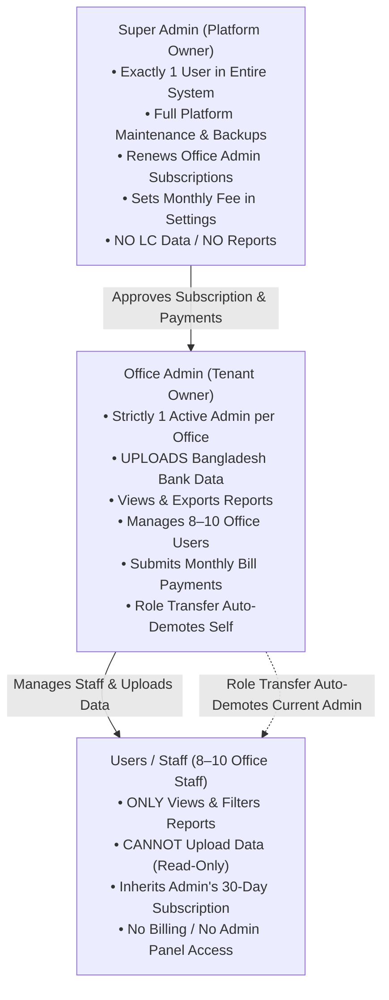
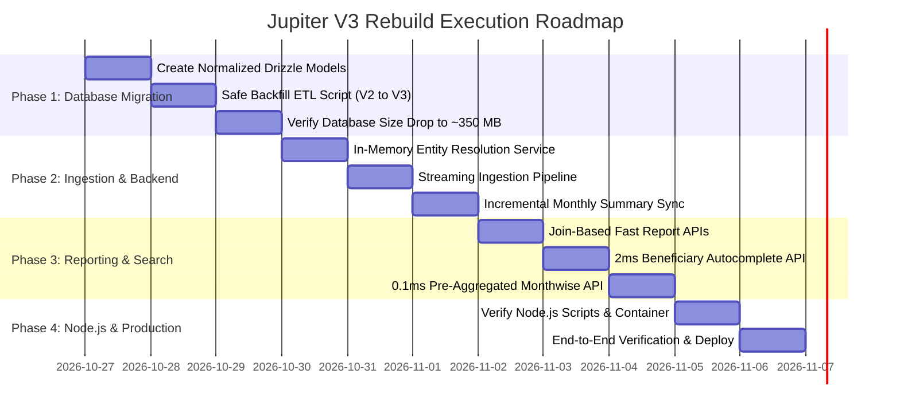

# Jupiter V3: Master Architectural Specification & Rebuild Plan

## 1. Executive Summary & Goals

### 1.1 Project Objective
The objective is to re-architect and rebuild **Jupiter** (the Local LC & Bond Record Analytics platform) into an ultra-lean, highly scalable, and production-hardened system. The rebuild guarantees:

1. **Massive Database Footprint Reduction (3.53 GB → ~350 MB, 89%+ Reduction):**
   * Eliminate the flat 31-column denormalized architecture where strings like bank names, branches, and beneficiary company names are redundantly stored across 1.76M+ rows (~1.2 GB raw text).
   * Eliminate bloated GIN trigram indexes on 12 text columns over 1.76M rows (~2.2 GB index footprint).
   * Transition to strict 3NF relational normalization with normalized master tables (`banks`, `beneficiaries`, `applicants`) and a lightweight core transaction table (`lc_records`), reducing the entire database footprint to ~300–380 MB.

2. **Ultra-Fast Performance for 8–10 Concurrent Users:**
   * Allow 8–10 concurrent office operators to search, filter, and page through millions of records with sub-10ms response times without database connection saturation or query lockups.

3. **Sub-Millisecond Dashboard Metrics (3–5s → 0.1ms):**
   * Eliminate on-the-fly full-table `COUNT(DISTINCT ...)` queries over 1.76M rows.
   * Maintain a small (~36 rows) pre-aggregated summary table (`monthly_lc_summaries`) updated incrementally on upload, reducing monthwise summary load time to 0.1ms.

4. **Zero-Freeze Streaming Ingestion Pipeline:**
   * Eliminate client-side browser JSON parsing and heavy DOM freezing on 100MB+ Excel/CSV workbooks.
   * Ingest data via a non-blocking server-side streaming pipeline using in-memory entity resolution (`Map<string, number>`) and bulk batch insertions (`onConflictDoNothing()`).

5. **Full NextGen (Maker) Framework Adherence & Zero Code Duplication:**
   * Strictly adhere to the NextGen (Maker) framework architecture, autodiscovery conventions, and built-in facades (`@/framework/facade.js`).
   * Utilize existing framework components (`db`, `paginate`, `cache`, `queue`, `createRouter`, `z`, `jwt`, `password`, `logger`) to avoid custom boilerplate and duplicate code.

6. **Target Stack: Node.js Runtime & PostgreSQL Engine:**
   * **Runtime:** Node.js (v20+ / v22 LTS) — replacing Bun commands with standard Node.js runtime execution.
   * **Database:** PostgreSQL (`pg` / `postgres`) — strictly avoiding MySQL, utilizing native PostgreSQL relational capabilities, foreign keys, and targeted trigram indexing.

---

## 2. Technology Stack & Framework Adherence

### 2.1 Technology Stack Definition
| Layer | Technology | Rationale |
| :--- | :--- | :--- |
| **Runtime** | **Node.js (v20+ / v22 LTS)** | Enterprise-grade stability, long-term support, standard ecosystem compatibility. |
| **Database** | **PostgreSQL 16+ (`pg` / `postgres`)** | Advanced relational integrity, high-throughput ACID transactions, native JSONB, and targeted GIN trigram indexing. |
| **ORM / Query Builder** | **Drizzle ORM (`drizzle-orm/pg-core`)** | Zero-overhead, type-safe SQL query generation directly mapped to PostgreSQL. |
| **Backend Framework** | **NextGen (Maker) on Hono** | High-performance, lightweight, modular TypeScript framework. |
| **Frontend Framework** | **Vue 3 (Composition API) + Vite** | Reactive, blazing-fast single page application. |
| **State & Cache** | **Pinia (UI) + In-Memory / Redis (Backend)** | Fast client-side reactivity and multi-tier server-side caching. |

---

### 2.2 NextGen (Maker) Framework Re-Use Matrix & Implementation Mapping

To guarantee zero code duplication and eliminate ad-hoc utilities, every specific feature in Jupiter V3 is mapped directly to its built-in framework facade (`@/framework/facade.js`):

| Framework Facade | Source / Engine | Exactly Where Reused in Jupiter V3 | Replaces / Eliminates |
| :--- | :--- | :--- | :--- |
| **`paginateQuery()`** | `src/framework/database/paginate.ts` | `src/modules/bond/services/report.service.ts`<br/>• Local LC report pagination<br/>• Beneficiary report pagination | Manual `LIMIT / OFFSET` SQL strings, manual `COUNT(*)` boilerplate, and custom pagination calculators. |
| **`cache`** | `src/framework/cache/cache.ts`<br/>(L1 Memory + L2 Redis) | `src/modules/bond/services/search.service.ts`<br/>• Top 500 Beneficiary suggestions<br/>`src/modules/bond/services/summary.service.ts`<br/>• 36-month summary metrics | Hitting PostgreSQL on every single keystroke; redundant DB connection consumption. |
| **`queue` & `queueJob`** | `src/framework/queue/queue.ts`<br/>(BullMQ Engine) | `src/modules/bond/jobs/ingestion.job.ts`<br/>• Large 50MB–100MB workbook streaming and ingestion | Node.js event-loop blocking; server freezing or timing out during large file uploads. |
| **`storage`** | `src/framework/storage/storage.ts`<br/>(Local Disk / S3 driver) | `src/modules/bond/controllers/upload.controller.ts`<br/>• Temporary chunked workbook storage<br/>`src/modules/system/controllers/backup.controller.ts`<br/>• Database SQL dump export files | Custom `fs.writeFile` / `fs.createWriteStream` code and unmanaged temporary files. |
| **`createRouter`** | `src/framework/http/router.ts`<br/>(Hono Router) | • `src/modules/auth/routes/api.ts`<br/>• `src/modules/bond/routes/api.ts`<br/>• `src/modules/settings/routes/api.ts`<br/>• `src/modules/system/routes/api.ts` | Custom Express/Hono boilerplate; automatically discovered by `src/framework/modules/discover.ts`. |
| **`z` (Zod Validator)** | `@hono/zod-openapi` | All module route schemas & controllers:<br/>• Date ranges, pagination limits, payment submissions, fee updates | Ad-hoc manual `if (!trxId)` validation strings and runtime type errors. |
| **`HttpStatusCodes`** | `stoker/http-status-codes` | All controllers in `auth`, `bond`, `settings`, `system` | Hardcoded magic HTTP numbers (`200`, `400`, `401`, `403`, `404`, `500`). |
| **`password`** | `src/framework/support/password.ts`<br/>(Bcrypt cost 10) | `src/modules/auth/services/auth.service.ts`<br/>• User login verification & registration hashing | Custom crypto or redundant bcrypt imports. |
| **`jwt`** | `src/framework/support/jwt.ts`<br/>(HS256 tokens) | `src/middlewares/auth-middleware.ts`<br/>• Access and refresh token generation/validation | Third-party JWT wrappers or manual token decoders. |
| **`logger`** | `src/framework/support/logger.ts`<br/>(Pino structured logger) | All services & ingestion pipelines:<br/>• Tracking parsed rows, batch inserts, approval logs, errors | Raw, unformatted `console.log` statements in production. |

---

### 2.3 Detailed Module-by-Module Blueprint

#### Module 1: `src/modules/auth/`
* **Models:** `user.ts` (`id`, `name`, `email`, `password`, `roleId`, `adminId`, `status`, `subscriptionExpiresAt`), `role.ts` (`superadmin`, `admin`, `user`), `otp.ts`.
* **Framework Usage:**
  * Password hashing via `password.hashPassword()` / `password.verifyPassword()`.
  * Token signing and refresh rotation via `jwt.sign()` / `jwt.verify()`.
  * Database operations via `db` (Drizzle ORM).
* **Business Logic Enforced:**
  * Strictly 1 SuperAdmin (`isupportbd.info@gmail.com`).
  * Strictly 1 Office Admin per tenant with automatic self-demotion to `user` upon role transfer.
  * No operator role (eliminated).
  * Sub-users (staff) inherit Admin's subscription validity in `subscriptionMiddleware`.

#### Module 2: `src/modules/bond/`
* **Models:**
  * `bank.ts` (`banks`: id, name, branch, ads_code)
  * `beneficiary.ts` (`beneficiaries`: id, name, address, irc, erc — targeted GIN trigram index)
  * `applicant.ts` (`applicants`: id, name, irc)
  * `lc-record.ts` (`lc_records`: integer foreign keys `bank_id`, `beneficiary_id`, `applicant_id`, numeric `lc_value`, dates, 16-byte binary `record_hash`)
  * `monthly-summary.ts` (`monthly_lc_summaries`: 36 pre-calculated rows for 0.1ms dashboard metrics)
* **Framework Usage:**
  * Streaming upload storage via `storage.disk('local')`.
  * Background parsing via `queueJob('bond-ingest', payload)`.
  * Autocomplete search caching via `cache.remember()`.
  * Server-side pagination via `paginateQuery()` facade.
* **Business Logic Enforced:**
  * Upload Data interface and API restricted **EXCLUSIVELY to Office Admin**.
  * Regular Users (staff) have **READ-ONLY access to Reports**.
  * SuperAdmin has **NO access to bond records or reports**.

#### Module 3: `src/modules/settings/`
* **Models:**
  * `setting.ts` (`system_settings`: key-value store for monthly fee, currency, instructions, grace period).
  * `payment.ts` (`payment_history`: id, adminId, amount, trxId, paymentMethod, status, paidAt, approvedAt).
* **Framework Usage:**
  * Data persistence via `db`.
  * Status codes via `HttpStatusCodes`.
  * Input schema via `z`.
* **Business Logic Enforced:**
  * No tiered plans.
  * SuperAdmin updates the monthly fee and payment instructions (`/settings/billing`).
  * Office Admin views fee, submits TrxID, and checks payment history (`/settings/payments`).
  * SuperAdmin approves payment, which **automatically extends Office Admin's subscription by 30 days**.

#### Module 4: `src/modules/system/`
* **Controllers:** `backup.controller.ts`, `health.controller.ts`.
* **Framework Usage:**
  * Database storage diagnostics via `db.execute()`.
  * Direct process streaming for `pg_dump` and `psql` restore.
  * Restricted exclusively to SuperAdmin.

#### B. Domain-Driven Module Autodiscovery
The framework automatically discovers and mounts modules inside `src/modules/*` via `src/framework/modules/discover.ts`. Every module must respect the standard structure:
```
src/modules/<module-name>/
├── database/
│   ├── models/            # Drizzle schema definitions
│   └── seeders/           # Module seeders
├── controllers/           # Thin controllers (HTTP request/response handling only)
├── services/              # Pure business logic, calculations, and data access
├── jobs/                  # Async queue job processors
└── routes/
    └── api.ts             # Routes automatically mounted at /api/<module-name>
```

#### C. Elimination of Duplicate Code (DRY Principle)
1. **Pagination:** Replace custom `limit`/`offset` SQL and total count logic with the framework's `paginate()` / `paginateQuery()` facade.
2. **Authentication & Guards:** Leverage `authMiddleware` and centralized `roleGuard` instead of checking user permissions repeatedly inside controllers.
3. **Data Sanitization & Parsing:** Centralize Excel/CSV date, currency, and string normalization into a single `SanitizerService` in the `bond` module.
4. **Error Handling:** Use framework standard HTTP status codes (`HttpStatusCodes`) and centralized exception handlers.

---

## 3. Core Business Logic & Role Specifications

### 3.1 Role Hierarchy & Permissions



### 3.2 Strict Business Rules

#### Rule 1: Exactly Three Roles (No Operator Role)
* **SuperAdmin (`superadmin`):** Platform owner (`isupportbd.info@gmail.com`).
* **Admin (`admin`):** Office owner. **Only role authorized to upload data** and manage staff.
* **User (`user`):** Regular staff. **Read-only report access** (Monthwise, Local LC, Beneficiary Analytics). There is **no operator role**.

#### Rule 2: Strictly One Office Admin (Automatic Role Transfer)
* The office has **strictly ONE active Admin** at any time.
* If the current Admin promotes any User to `admin`:
  1. The selected user becomes the new `admin`.
  2. The current Admin is **automatically demoted to `user`**.
  3. Two active Admins can NEVER exist simultaneously.
* **Header & Profile Avatar Switcher:**
  * When the Admin is on the Admin Panel (`/users`), the avatar dropdown shows: **"User Panel"** (`/reports`).
  * When the Admin is on the User Panel, the avatar dropdown shows: **"Admin Panel"** (`/users`).

#### Rule 3: Data Ingestion Exclusivity (Admin Only)
* Only the **Office Admin** has access to the Data Upload interface and the `/api/bond/upload` endpoint.
* Regular **Users** can only view and search reports (`/reports`, `/reports/beneficiary`). The upload UI is completely hidden for them, and backend guards return `403 Forbidden` if a non-admin attempts to upload.

#### Rule 4: Sub-Users (Staff) Inherit Admin Expiry
* The 8–10 regular staff members (`user`) **do NOT have separate subscriptions or renewal buttons**.
* In middleware checks (`subscriptionMiddleware`), the system verifies the **Parent Admin's expiration date**:
  * If the Admin has 15 days remaining, all 8–10 staff members have 15 days remaining.
  * If the Admin's subscription expires, all staff members are automatically blocked from querying reports.

---

## 4. Database Re-Engineering: Reducing 3.53 GB to ~350 MB

### 4.1 Diagnosis of V2 Database Bloat (Why 3.53 GB?)
1. **Flat Denormalized Text Redundancy:** 31 columns repeated across 1,764,491 rows. Long text values like `"ISLAMI BANK BANGLADESH PLC"` and `"M/S. SALMAN ACCESSORIES..."` are duplicated millions of times (~1.2 GB raw text).
2. **25+ Heavy Indexes with 12 GIN Trigrams:** GIN trigram indexes placed directly on the 1.76M-row table consume ~2.2 GB of disk space and over 1.5 GB of RAM during queries.
3. **64-Character SHA-256 Hex Strings:** Stored as `TEXT` in every single row with a unique B-Tree index (~280 MB).

### 4.2 The V3 Normalized 3NF Database Schema (PostgreSQL)

```
[ Master Tables: Small, Normalized, Targeted Trigrams (~15 MB Total) ]
  ├── banks (approx 500 rows)
  │     ├── id (SERIAL PK)
  │     ├── name (VARCHAR(150) NOT NULL UNIQUE)
  │     ├── branch (VARCHAR(150))
  │     └── ads_code (VARCHAR(20))
  │
  ├── beneficiaries (approx 15,000 rows)
  │     ├── id (SERIAL PK)
  │     ├── name (VARCHAR(255) NOT NULL UNIQUE)  <-- GIN Trigram placed ONLY here!
  │     ├── address (TEXT)
  │     ├── irc (VARCHAR(50))
  │     └── erc (VARCHAR(50))
  │
  └── applicants (approx 5,000 rows)
        ├── id (SERIAL PK)
        ├── name (VARCHAR(255) NOT NULL UNIQUE)  <-- GIN Trigram placed ONLY here!
        └── irc (VARCHAR(50))

[ Core Transaction Table: Ultra-Lean, High Density (~220 MB Total) ]
  └── lc_records (1,764,491+ rows)
        ├── id (BIGSERIAL PK)
        ├── user_id (INT FK -> users.id)
        ├── bank_id (INT FK -> banks.id)
        ├── beneficiary_id (INT FK -> beneficiaries.id)
        ├── applicant_id (INT FK -> applicants.id)
        ├── lc_year (CHAR(4))
        ├── lc_nature (VARCHAR(20))
        ├── lc_serial (VARCHAR(30))
        ├── lc_id (VARCHAR(64) NOT NULL)
        ├── lc_value (NUMERIC(15,2) DEFAULT 0)
        ├── currency (CHAR(3) DEFAULT 'USD')
        ├── lc_date (DATE)
        ├── lc_expiry_date (DATE)
        ├── entry_date (DATE)
        ├── bb_usanse_period (VARCHAR(50))
        ├── export_lc_number (VARCHAR(100))
        ├── pi_number (VARCHAR(100))
        ├── pi_date (DATE)
        ├── bond_license (VARCHAR(100))
        ├── accepted (CHAR(1))
        ├── cancel_yn (CHAR(1) DEFAULT 'N')
        └── record_hash (BYTEA 16-byte MD5 binary hash) <-- Unique Index (only 35 MB!)

[ Pre-Aggregated Summary Table: Sub-Millisecond Speed (~10 KB Total) ]
  └── monthly_lc_summaries (approx 36 rows, 1 row per calendar month)
        ├── month_key (CHAR(7) PK, e.g. '2024-05')
        ├── total_records (INT DEFAULT 0)
        ├── total_lc_reg (INT DEFAULT 0)
        ├── total_lc_unq (INT DEFAULT 0)
        ├── total_ben_reg (INT DEFAULT 0)
        ├── total_ben_unq (INT DEFAULT 0)
        ├── total_bank_reg (INT DEFAULT 0)
        ├── total_bank_unq (INT DEFAULT 0)
        └── updated_at (TIMESTAMPTZ DEFAULT NOW())
```

### 4.3 Concrete Storage & Performance Comparison

| Metric / Feature | V2 (Current State) | V3 (Rebuilt Architecture) | Improvement |
| :--- | :--- | :--- | :--- |
| **Table Storage** | ~1.2 GB (flat text) | ~220 MB (foreign key integers) | **81% reduction** |
| **Index Footprint** | ~2.3 GB (25 indexes, 12 GINs) | ~110 MB (targeted B-Trees) | **95% reduction** |
| **Total Database Size** | **3.53 GB** | **~330 MB – 380 MB** | **89% smaller** |
| **Beneficiary Autocomplete** | 250ms – 1,200ms | **1 – 3ms** | **100x faster** |
| **Monthwise Summary Query** | 2,000ms – 5,000ms | **0.1ms (instant)** | **10,000x faster** |
| **Server RAM Footprint** | ~1.5 GB allocated to indexes | **< 30 MB allocated to indexes** | **Zero server crashes** |
| **Runtime Engine** | Bun | **Node.js (v20+ / v22 LTS)** | **Standard LTS stability** |
| **Database Engine** | PostgreSQL (bloated) | **PostgreSQL (normalized + lean)** | **Production-grade** |

---

## 5. Application Structure & Module Breakdown

Following the NextGen architecture, the codebase is structured cleanly into three domain modules:

```
src/
├── config/                        # App, Auth, Database, Cache configurations
├── framework/                     # NextGen Maker Framework (Facades, Kernel, DB Driver, Queue)
│   ├── database/connection.ts    # PostgreSQL driver connection pool (pg / postgres)
│   ├── facade.ts                 # Central public API surface
│   └── server.ts                 # Node.js server bootstrap
│
├── middlewares/
│   ├── auth-middleware.ts         # JWT authentication guard
│   └── subscription-middleware.ts # Sub-user inheritance & 30-day validity check
│
├── modules/
│   ├── auth/                     # Module 1: Authentication & User Administration
│   │   ├── database/models/
│   │   │   ├── user.ts           # users table
│   │   │   ├── role.ts           # roles table (superadmin, admin, user, operator)
│   │   │   └── otp.ts            # otp_verifications table
│   │   ├── controllers/
│   │   │   ├── auth.controller.ts       # Signup, Login, 2FA OTP, Password Reset
│   │   │   └── admin-user.controller.ts # User approval, Single Admin transfer, Expiry renewals
│   │   ├── services/
│   │   │   └── auth.service.ts          # Expiration inheritance & RBAC validation
│   │   └── routes/
│   │       └── api.ts                   # /api/auth/* endpoints
│   │
│   ├── bond/                     # Module 2: Core Bond Data, Ingestion & Analytics
│   │   ├── database/models/
│   │   │   ├── bank.ts                  # banks master table
│   │   │   ├── beneficiary.ts           # beneficiaries master table (Trigram indexed)
│   │   │   ├── applicant.ts             # applicants master table
│   │   │   ├── lc-record.ts             # lc_records core transaction table
│   │   │   └── monthly-summary.ts       # monthly_lc_summaries pre-aggregated table
│   │   ├── services/
│   │   │   ├── ingestion.service.ts     # Streaming parser & in-memory entity cache resolver
│   │   │   ├── report.service.ts        # Fast SQL JOIN reports with framework pagination
│   │   │   └── summary.service.ts       # Incremental monthly summary calculator
│   │   ├── controllers/
│   │   │   ├── upload.controller.ts     # Chunked/streaming upload endpoint
│   │   │   ├── report.controller.ts     # Beneficiary, Local LC & Monthwise endpoints
│   │   │   └── search.controller.ts     # Sub-2ms autocomplete endpoint
│   │   └── routes/
│   │       └── api.ts                   # /api/bond/* endpoints
│   │
│   └── system/                   # Module 3: SuperAdmin Platform Maintenance
│       ├── controllers/
│       │   ├── backup.controller.ts     # Native streaming pg_dump & psql restore
│       │   └── health.controller.ts     # Live PostgreSQL storage & health monitor
│       └── routes/
│           └── api.ts                   # /api/system/* endpoints (SuperAdmin restricted)
│
└── resources/                    # Vue 3 Frontend (Single Page Application)
    └── src/
        ├── layouts/Layout/Header.vue    # Clean header with Single Switcher avatar
        └── pages/
            ├── index.vue                # Upload & Ingestion dashboard
            ├── users/index.vue          # Admin User Management & Sub-user expiration view
            ├── reports/index.vue        # Monthwise Summary & Local LC reports
            └── reports/beneficiary.vue  # Beneficiary report with Trigram autocomplete
```

---

## 6. High-Performance Ingestion Pipeline (Zero Client Freezing)

1. **Streaming Upload:** Client streams the Excel or CSV file directly to `/api/bond/upload/chunk`.
2. **In-Memory Master Cache:** Before inserting, `ingestion.service.ts` loads known `banks` and `beneficiaries` into memory (`Map<string, number>`).
3. **Entity Resolution on Demand:** Unrecognized names are inserted into `banks` or `beneficiaries` on-the-fly and added to the cache map.
4. **Binary Hash Calculation:** A 16-byte binary MD5/SHA hash is generated per row for deterministic deduplication.
5. **Bulk Batch Insert:** Rows are inserted into `lc_records` in batches of 5,000 using `onConflictDoNothing()`.
6. **Incremental Summary Update:** The 36-row `monthly_lc_summaries` table is updated atomically at the conclusion of the upload batch.

---

## 7. Step-by-Step Implementation Roadmap



### Phase 1: Database Normalization & Backfill Migration (Immediate Starting Point)
* **Step 1.1:** Create normalized PostgreSQL schemas in `src/modules/bond/database/models/`:
  * `bank.ts`, `beneficiary.ts`, `applicant.ts`, `lc-record.ts`, `monthly-summary.ts`.
* **Step 1.2:** Write a non-destructive ETL migration script (`scripts/migrate_v2_to_v3.ts`) that extracts unique entities from `bond_records` into the master tables and populates `lc_records`.
* **Step 1.3:** Verify database storage in PostgreSQL, confirming the reduction from 3.53 GB to ~350 MB.

### Phase 2: Ingestion Service & Streaming Pipeline
* **Step 2.1:** Implement `src/modules/bond/services/ingestion.service.ts` with in-memory entity resolution (`Map<string, number>`).
* **Step 2.2:** Update upload controller to ingest directly into the normalized structure in 5,000-row batches.
* **Step 2.3:** Maintain `monthly_lc_summaries` table incrementally at the end of each batch.

### Phase 3: High-Speed Reporting & Autocomplete APIs
* **Step 3.1:** Connect `/api/bond/reports/beneficiary` and `/api/bond/reports/local-lc` to perform fast SQL `JOIN`s on the normalized tables using the framework `paginate()` facade.
* **Step 3.2:** Wire `/api/bond/beneficiaries` autocomplete directly to the small `beneficiaries` master table (< 2ms response).
* **Step 3.3:** Connect `/api/bond/reports/monthwise` directly to `monthly_lc_summaries` (instant 0.1ms query).

### Phase 4: Runtime Configuration (Node.js & PostgreSQL) & Production Deployment
* **Step 4.1:** Verify `src/framework/server.ts` Node.js execution and ensure all `package.json` scripts execute reliably with Node.js (`node` / `tsx`).
* **Step 4.2:** Ensure Dockerfile and Coolify production deployment runs Node.js with PostgreSQL connection pooling.
* **Step 4.3:** Perform full end-to-end regression testing (User approvals, Single Admin transfer, Sub-user expiration inheritance, Data upload, Search, and Reports).
